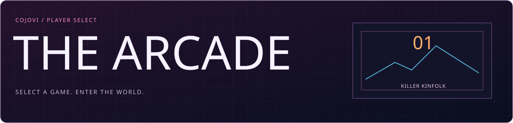
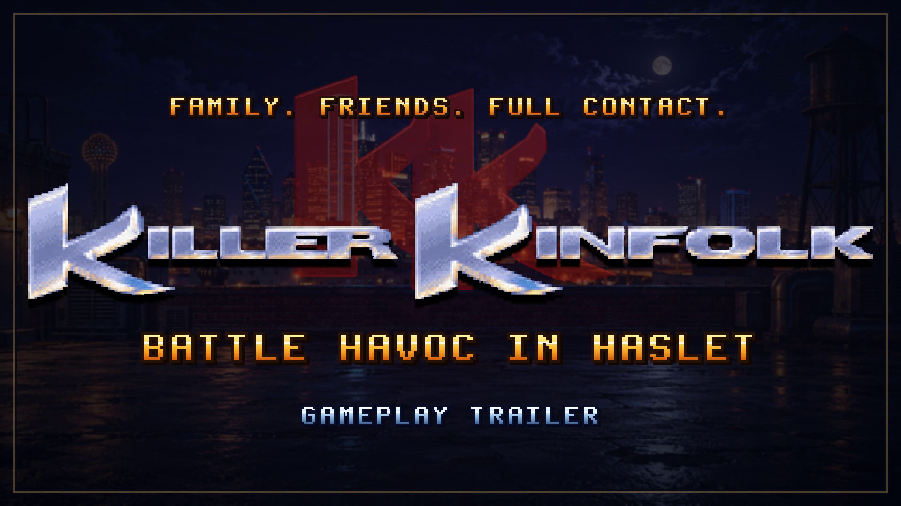
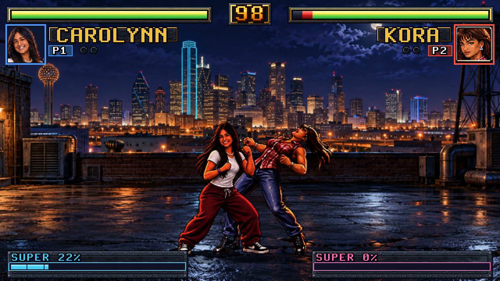
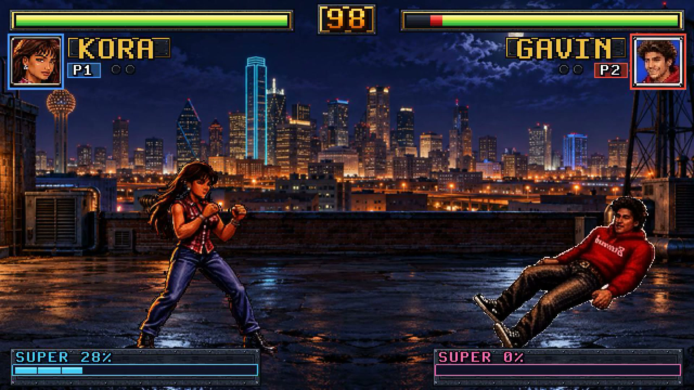

<picture>
  <source media="(max-width: 640px)" srcset="assets/arcade-mobile.svg">
  
</picture>

# Killer Kinfolk

**A 16-bit-inspired fighting game with a custom combat simulation and a whole lot of arcade attitude.** Built in Godot by [Cody / COJOVI](https://github.com/cojovi), with family and friends reimagined as fighters.

`Godot 4.7` · `GDScript` · `60-step simulation` · `2D fighter` · `In development`

**[▶ Watch the gameplay trailer and explore the arcade →](https://cojovi.github.io/killer-kinfolk-showcase/)**

The 45-second trailer uses real game captures from controlled exhibitions. The matches are driven through the game's input and simulation systems; they are not recordings of human matches. [Trailer credits](credits/TRAILER-CREDITS.md).

## Select your fighter

Nine playable fighters, six-button movesets, ranged attacks, signature moves, and teammate assists give the game its own arcade identity. The current game includes Arcade, local Versus, and Training modes. It is a personal project in development; this showcase is a case study and trailer, **not a playable download**.

<table><tr><td width="50%"></td><td width="50%"></td></tr></table>

*Still frames from the supplied gameplay trailer.*

## The engineering behind the arcade

| System | Design |
|---|---|
| **Combat simulation** | A 60-step-per-second integer simulation tracks fighter states, match phases, collision, projectiles, hitstop, round timing, and gameplay events. |
| **Command input** | A serializable input history converts directional input relative to fighter facing and recognizes motion sequences, button edges, and charge timing. |
| **Data-driven fighters** | JSON-backed fighter definitions supply movement, hitboxes, moves, and other attributes to a shared simulation. |
| **Presentation** | Fighter sprites, stages, camera, effects, audio, and HUD render the match while the simulation owns gameplay state. |
| **Practice and modes** | Arcade and local Versus sit alongside Training features such as dummy behavior, frame stepping, hitbox display, and frame data. |

The source project includes headless suites for simulation, AI, input-related mechanics, assists, and presentation smoke checks. **Those game suites were not run for this showcase release**; no test-pass count is claimed. The trailer was inspected locally and its supplied file was verified as 45 seconds, 1920×1080, 60 fps.

## About this showcase

The full game repository remains private. This public page shares a curated trailer, stills, project description, and a high-level engineering overview; it does not expose a playable build or private repository history. The trailer contains the game's supplied guest-character depictions and existing production audio; see its [credits and notices](credits/TRAILER-CREDITS.md) for source and attribution details. The game and its media are not accompanied by a new open-source license here.

[Open the arcade experience →](https://cojovi.github.io/killer-kinfolk-showcase/) · [More work →](https://github.com/cojovi) · [Artwork font licenses](assets/FONT-LICENSES.txt)
